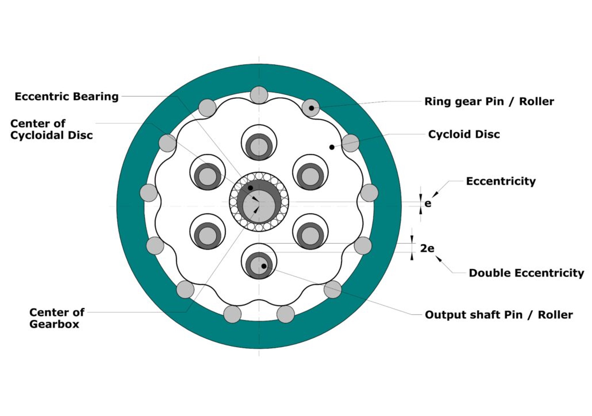
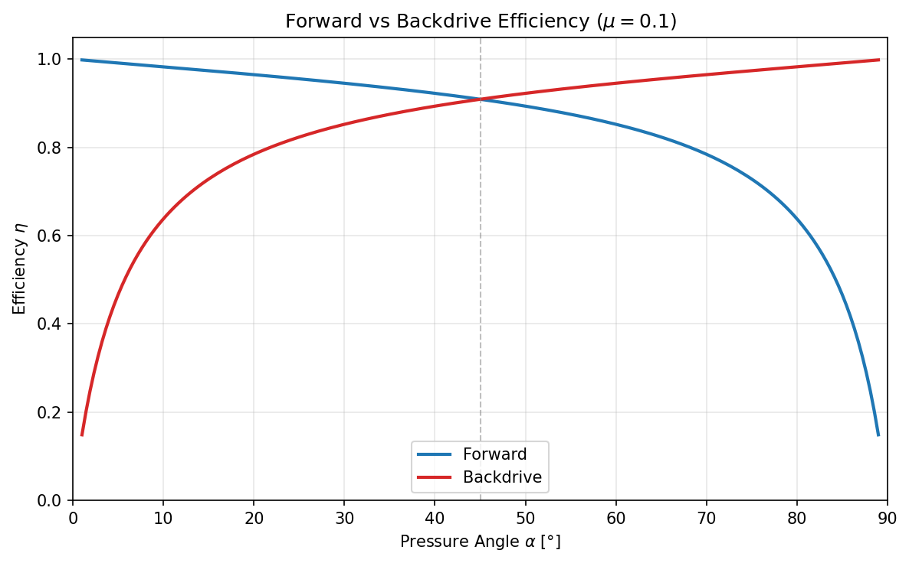

# Cycloidal Drive

Shared background for the reduction stage used in `motor_L`, `motor_M`, and `motor_S`.

## Transmission ratio

With $N_l$ being the number of lobes on the cycloidal disk and $N_p$ being the number of pins in the outer ring, the transmission ratio is defined as

$$i = \frac{N_l}{N_p - N_l}$$

In most cases $N_p = N_l + 1$, which results in a transmission ratio of $N_l:1$.

## Eccentricity

The eccentricity $e$ defines how much the cycloidal disk's center point is offset from the center axis, and therefore how much the disk engages with the ring gear pins. A lower $e$ results in less unbalance but also a higher pressure angle between disk and pins.

## Pressure angle

> The pressure angle is defined as the angle between the common normal at the cycloid–pin contact and the instantaneous velocity direction at that point. In other words, it determines how effectively the contact force is converted into torque. When the pressure angle is lower within the working region, several benefits occur: load transmission improves, sliding is reduced, efficiency increases, heat generation decreases, wear is minimized, and transmission error is lowered.
>
> Source: https://mevirtuoso.com/gears/what-is-pressure-angle-and-why-its-important-cycloidal-drives

The pressure angle is directly impacted by:

- Eccentricity $e$
- Ring gear diameter $D$

[This simulator](https://mevirtuoso.com/cycloidal-drive/) numerically calculates the pressure angle for a given configuration as a function of input rotation angle.

### Impact on forward and backdrive efficiency

#### Force decomposition

At a cycloidal pin contact, the contact force $F_n$ splits along the pressure angle $\alpha$:

- $F_n \cos(\alpha)$: tangential to motion (drives output)
- $F_n \sin(\alpha)$: normal to motion (radial reaction)

Friction at the contact: $F_{fric} = \mu \cdot F_n$, acting against sliding.

#### Forward efficiency

When power flows input → output, the useful component is tangential ($\cos\alpha$), the loss is along the sliding direction ($\sin\alpha$):

$$\eta_{fwd} = \frac{\cos\alpha}{\cos\alpha + \mu \sin\alpha} = \frac{1}{1 + \mu \tan\alpha}$$

#### Backdrive efficiency

When power flows output → input, the geometry inverts which component is useful. The radial direction ($\sin\alpha$) couples back into the input shaft via the eccentricity lever:

$$\eta_{back} = \frac{\sin\alpha}{\sin\alpha + \mu \cos\alpha} = \frac{1}{1 + \mu \cot\alpha}$$

### Number of engaged pins (rule of thumb)

$$N_{eff} \approx \frac{N_p}{4}$$

- Half of all pins lie in the load-bearing zone ($\alpha < 90°$)
- Of those, only ≈50% carry significant load due to manufacturing tolerances:

$$N_{eff} = \frac{N_p}{2} \cdot \frac{1}{2} = \frac{N_p}{4}$$

## Maximum force calculations

### Maximum pin normal force

Conservative estimate including a peak factor of 2 for uneven load distribution among engaged pins:

$$F_{p,max} = \frac{2 \cdot T_{out}}{N_{eff} \cdot R_p \cdot \cos(\alpha_{min})}$$

where $\alpha_{min}$ is the minimum pressure angle within the load-bearing region (read from the $\alpha(\theta)$ curve).

### Maximum output shaft pin force

$$F_{out,max} = \frac{4\, T_{out}}{N_{out} \cdot R_{out}}$$

## Hertz pressure (pin–hole, line contact)

### Effective elastic modulus $E^*$

For contact between two bodies with different materials:

$$E^* = \frac{E_1 \cdot E_2}{E_2 (1 - \nu_1^2) + E_1 (1 - \nu_2^2)}$$

where $E_i$ and $\nu_i$ are Young's modulus and Poisson's ratio of body $i$. For identical materials this reduces to:

$$E^* = \frac{E}{2(1 - \nu^2)}$$

Equivalent radius for convex-concave contact:

$$R_{eq} = \frac{R_{pin} \cdot R_{hole}}{R_{hole} - R_{pin}}$$

Maximum contact pressure:

$$p_{max} = \sqrt{\frac{F \cdot E^*}{\pi \cdot b \cdot R_{eq}}}$$

with $b$ = pin contact length.

## Eccentric bearing load

With safety factor $K$ (often 2–3):

$$F_{bearing,max} = K \cdot \frac{T_{out}}{i \cdot e}$$
